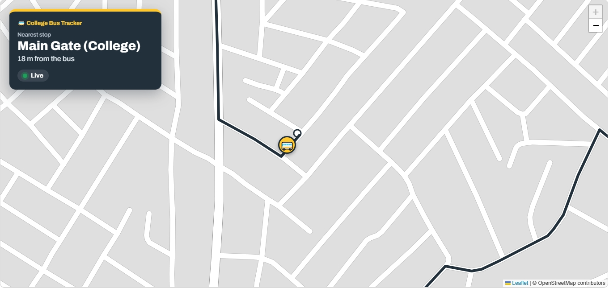
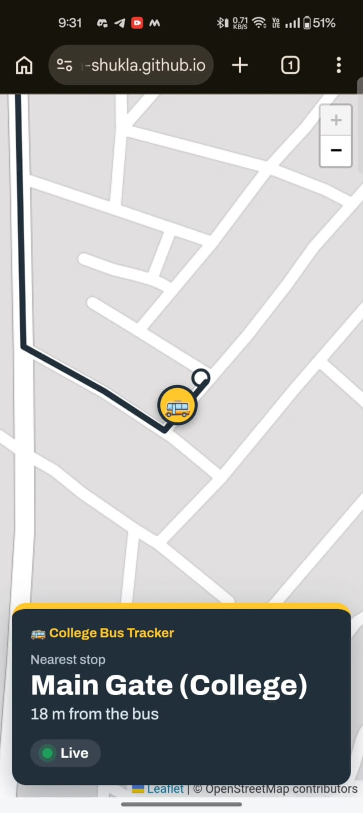
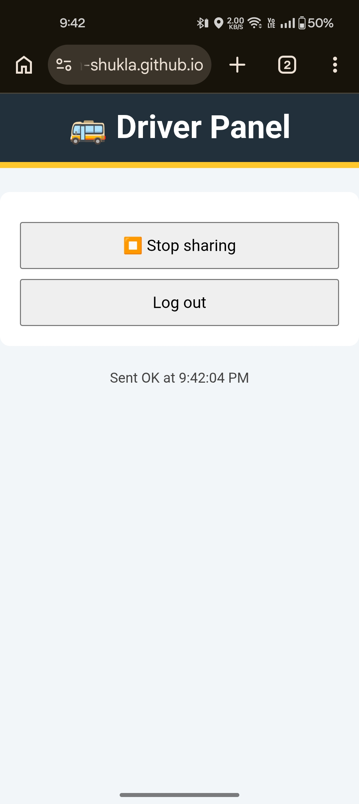

# 🚌 College Bus Tracker

A real-time web app that shows students where the college bus is, live on a map.

**Live demo:** https://Akarsh-Shukla.github.io/College-Bus-Tracker/

## The problem
Students wait at bus stops without knowing whether the bus has passed or is running late.

## The solution
The driver opens a page on their phone and taps **Start sharing**. The phone's GPS location goes to Firebase, and students see the bus move on a map in real time, with the nearest stop and a live/offline status.

## Built with
HTML, CSS, JavaScript, Leaflet + OpenStreetMap, OSRM (road routing), Firebase Realtime Database and Authentication, GitHub Pages

## Screenshots

  
  

## Author
Akarsh Shukla, BCA student · [LinkedIn](www.linkedin.com/in/akarsh-shukla2026)